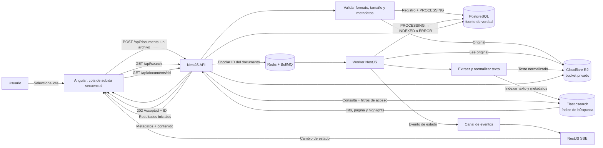

# Arquitectura: carga, indexación, búsqueda y visualización

## Propósito y decisiones base

La aplicación permite cargar documentos técnicos, procesarlos e indexarlos en segundo plano, recibir cambios de estado en tiempo real, buscar por contenido y visualizar un documento. El diseño usa Angular + TypeScript (con Spartan NG y Tailwind CSS), NestJS + TypeScript, PostgreSQL, Elasticsearch, Redis + BullMQ y Server-Sent Events (SSE). Docker Compose coordina el entorno de desarrollo y demostración.

Los estados persistidos del documento son `RECEIVED`, `PROCESSING`, `INDEXED` y `ERROR`, según `docs/decisiones-tecnicas.md`. La v1 crea los documentos directamente en `PROCESSING` para cumplir HU-01 y conserva `RECEIVED` por compatibilidad. Angular los presenta con etiquetas traducidas al español o al inglés. `PENDIENTE` y `SUBIENDO` pertenecen solamente a la cola temporal de Angular.

## Razones del stack elegido

| Tecnología | Motivo de selección | Costo o límite que se acepta |
| --- | --- | --- |
| Angular + TypeScript + Spartan NG | Resuelve una interfaz con varios estados coordinados: selección de lote, subida secuencial, progreso por documento, búsqueda, filtros, visor y actualización SSE. Spartan NG aporta primitivas accesibles sobre Angular CDK y estilos Tailwind que se copian al proyecto; no impone una versión fija de Angular. | Requiere mantener los componentes helm copiados, Tailwind CSS 4 y una capa propia para i18n, temas y carga de archivos, que Spartan no incluye. |
| NestJS + TypeScript | Organiza API REST, validación, permisos, servicios de documento, integración con BullMQ y endpoints SSE bajo módulos y proveedores separados. El mismo lenguaje y tipos facilitan mantener contratos con Angular. | El backend debe separar API y worker en procesos ejecutables distintos para que extracción intensiva no afecte peticiones y streams SSE. |
| PostgreSQL | Mantiene relaciones y restricciones para metadatos, versiones, permisos y estados, además de transacciones para registrar documentos y eventos outbox si se implementan. | No será el motor de búsqueda de contenido en esta decisión; hay que mantener consistencia eventual con la proyección Elasticsearch. |
| Elasticsearch | Cubre texto completo sobre contenido y metadatos, relevancia ponderada, filtros, paginación y fragmentos resaltados. Se alinea directamente con los requisitos de búsqueda y evita consultas `LIKE`. | Añade un servicio que configurar, vigilar y reconciliar. El volumen máximo aún no se conoce y su capacidad deberá comprobarse con pruebas representativas. |
| Redis + BullMQ | Mantiene trabajos asíncronos independientes, reintentos, backoff y concurrencia configurable para extracción e indexación. | Redis es una dependencia adicional y no reemplaza la cola secuencial de subida de Angular. Los trabajos deben ser idempotentes porque pueden reintentarse. |
| SSE | El flujo requerido es principalmente unidireccional: el servidor notifica cambios de estado al navegador. Es apropiado para progreso sin polling; Angular usa HTTP para enviar cargas y búsquedas. | Una conexión SSE puede cortarse; la interfaz debe reconectar y consultar el estado persistido. El balanceador debe permitir conexiones HTTP de larga duración. |
| Autenticación mínima | Registro e inicio de sesión con email/contraseña, sesión por cookie HttpOnly y API keys personales. Cubre el acceso privado sin construir RBAC ni un proveedor externo. | Requiere implementar hash de contraseñas, CSRF, límites de intentos, revocación de sesiones/API keys y la UI de registro, login y gestión de claves. |
| Almacenamiento de objetos | Cloudflare R2 como almacenamiento principal de originales y texto normalizado, en bucket privado y detrás de una interfaz de almacenamiento; MinIO opcional solo para tests offline. | R2 añade dependencia de red/proveedor, coste de operaciones y necesidad de CORS, URLs firmadas y ciclo de vida; no garantiza la disponibilidad de PostgreSQL, Redis, Elasticsearch ni de la plataforma. |
| Docker Compose | Permite levantar el conjunto de dependencias de forma reproducible en desarrollo y demostración. | Su uso queda limitado al entorno local; no determina la plataforma de producción. |

La selección responde a los requisitos funcionales de la prueba original, pero la incorporación de autenticación, i18n y temas amplía el alcance más allá de un día. Para mantener la primera versión acotada, se limita a un flujo de ingestión, un índice explícito, una búsqueda paginada y una interfaz SSE; no incluye OCR ni búsqueda semántica. DOCX no es un requisito del enunciado original y queda fuera de la aceptación de la v1; el código existente se conserva como soporte opcional.

## Diagrama de arquitectura y flujo

## Flujo de carga e indexación

1. Angular permite seleccionar un lote de tamaño variable. Mantiene una cola local y envía un solo archivo a la vez. El archivo siguiente no empieza a subirse hasta que el backend responde al anterior.
2. Angular envía cada archivo y sus metadatos a `POST /api/documents` como `multipart/form-data`.
3. NestJS valida autorización, formato real, tamaño, nombre de archivo, campos y metadatos. Se aceptan TXT UTF-8, Markdown UTF-8 y PDF con texto extraíble. DOCX no es requisito de la v1; el código existente lo admite como soporte opcional. El nombre se normaliza y se rechazan rutas, caracteres de control, nombres reservados y longitudes excesivas; la clave de R2 usa UUID y extensión, no el nombre original. No se hace OCR en esta versión.
4. El backend conserva el original en Cloudflare R2 mediante AWS SDK para JavaScript y endpoint compatible con S3, detrás de una interfaz de almacenamiento. El bucket es privado; para tests offline se puede usar MinIO con la misma interfaz.
5. PostgreSQL registra metadatos, clave de objeto estable, tamaño, MIME, checksum y estado inicial `PROCESSING`. La solicitud devuelve `202 Accepted` con `trackingId` solo cuando archivo y trabajo quedaron aceptados de forma recuperable.
6. NestJS publica en BullMQ un trabajo que contiene el ID del documento y referencias necesarias, no los bytes del archivo. El estado pasa a `PROCESSING` mientras el trabajo espera o está activo. Si se implementa transactional outbox, el evento pendiente se escribe en PostgreSQL dentro de la misma transacción del registro; un dispatcher lo publica a Redis.
7. El worker recupera el archivo, extrae y normaliza texto, y guarda el texto con una clave de objeto estable para que el visor pueda leerlo y el índice pueda reconstruirse. El original se conserva según la política de retención.
8. El worker envía a Elasticsearch una proyección con el texto indexable, título, descripción, metadatos, etiquetas, versión e identificador estable. El trabajo debe ser idempotente, usando el ID del documento como clave para que un reintento no duplique resultados.
9. Una vez que Elasticsearch confirma la operación de indexación, el backend actualiza el registro PostgreSQL a `INDEXED`. Si ocurre un fallo definitivo o se agotan los reintentos, registra `ERROR` y un código/mensaje visible. Los errores transitorios pueden reintentarse según la política de BullMQ.
10. El cambio de estado se publica como evento SSE. El error de un archivo solo afecta a ese documento; Angular muestra su resultado y continúa con el próximo elemento de la cola.

### Fallos y consistencia

- PostgreSQL es la fuente de verdad para metadatos y estado. Elasticsearch es un índice derivado que se puede reconstruir a partir del contenido conservado.
- Almacenar el archivo y publicar el trabajo en Redis son operaciones entre sistemas distintos y no forman una transacción distribuida. Si se necesita garantizar la publicación tras una caída entre ambas operaciones, implementar transactional outbox. Para un prototipo sin outbox, añadir compensación y reconciliación que detecten documentos atascados en `PROCESSING` y objetos sin registro.
- Si el almacenamiento falla antes de que la API acepte la carga, responder con error y no crear un documento procesable. Si falla la publicación del trabajo después de guardar el registro, no dejarlo indefinidamente en `PROCESSING`; recuperar mediante outbox o marcar error recuperable y permitir reintento.
- BullMQ puede volver a ejecutar trabajos; extracción, escritura del texto normalizado e indexación deben ser idempotentes. Limitar reintentos, registrar el último error y permitir reintento individual.
- No marcar `INDEXED` hasta que Elasticsearch confirme el documento. Si la actualización de estado en PostgreSQL falla después de indexar, la reconciliación debe completar el estado sin crear duplicados.
- PDF protegido, corrupto o sin texto extraíble termina en `ERROR` con código y mensaje comprensibles. El worker continúa con los demás trabajos y Angular continúa con los archivos restantes.
- El usuario puede reconectar SSE y consultar `GET /api/documents/:id` para obtener el estado vigente. SSE complementa la consulta persistida; no es la única copia del estado.

## Errores, reintentos y cargas simultáneas

### Una operación de lote, trabajos independientes

Angular permite seleccionar varios archivos e iniciar una sola carga múltiple desde la interfaz. El frontend conserva una cola con el progreso por archivo, pero hace una solicitud `POST /api/documents` por cada documento y espera la respuesta antes de subir el siguiente. Así se mantiene la subida secuencial acordada sin convertir el lote entero en una única transacción HTTP.

La API expone además `POST /api/documents/batch` para clientes que no usan Angular: recibe `files[]` y un campo `metadata` con un arreglo JSON alineado por índice, crea un documento y un trabajo independiente por archivo, y devuelve `202 Accepted` con resultados parciales. Angular no usa este endpoint; conserva la subida secuencial uno por uno. El batch tiene límites de cantidad, tamaño por archivo y tamaño total para proteger la memoria del proceso.

Cada documento aceptado crea un trabajo BullMQ independiente, identificado con el ID estable del documento. Un error en validación, transferencia o procesamiento queda asociado a ese elemento. Angular registra el fallo y continúa con el siguiente archivo; un job fallido o en backoff no debe detener otros jobs listos. Pueden coexistir varios lotes o usuarios. El límite de subida es uno por lote desde Angular; la concurrencia de workers es independiente y configurable.

### Clasificación y política de recuperación

| Clase | Ejemplos | Tratamiento |
| --- | --- | --- |
| Permanente / requiere corregir el archivo | `UNSUPPORTED_FILE_TYPE`, `FILE_REQUIRED`, `FILE_TOO_LARGE`, `BATCH_TOO_LARGE`, `INVALID_MULTIPART`, `INVALID_FILENAME`, `EMPTY_FILE`, `INVALID_METADATA`, `DUPLICATE_FILE`, `FILE_CORRUPTED`, `PASSWORD_PROTECTED`, `UNSUPPORTED_ENCODING`, `NO_EXTRACTABLE_TEXT`, `OCR_REQUIRED`, `DOCX_CORRUPTED`, `DOCX_ENCRYPTED`, `DOCX_EXTRACTION_FAILED` o `STORAGE_OBJECT_NOT_FOUND`. | No reintentar automáticamente. Mostrar la causa y una acción correctiva. El usuario puede subir una versión corregida como nuevo intento. |
| Transitorio / posiblemente recuperable | `UPLOAD_FAILED`, `STORAGE_UNAVAILABLE`, `QUEUE_UNAVAILABLE`, `PROCESSING_TIMEOUT`, `SEARCH_ENGINE_UNAVAILABLE`; otros fallos de infraestructura claramente temporales. | Permitir hasta 3 reintentos adicionales (4 intentos totales), con backoff exponencial y variación aleatoria (jitter), manteniendo idempotencia. Angular reintenta transferencias y BullMQ jobs aceptados; agotados los intentos se registra el error y la cola avanza. |
| Desconocido | Error no clasificado de extracción o indexación. | Registrar una referencia de soporte; no marcar como recuperable sin evidencia. Si el job es idempotente, ofrecer reintento manual individual después de revisar la causa. |

Al agotarse los reintentos, el documento termina en `ERROR` con código y causa legible. El usuario puede solicitar un reintento manual individual después de corregir la causa, cuando corresponda. Los errores permanentes se marcan fallidos sin consumir reintentos inútiles. Si una respuesta se pierde después de que el servidor aceptó el archivo, Angular reutiliza la clave de idempotencia para evitar crear un duplicado.

### Progreso y resumen del lote

- Para cada archivo, la UI muestra nombre, estado de transferencia/procesamiento, mensaje y si existe acción de reintento.
- Estados como `PENDIENTE` y `SUBIENDO` pertenecen al frontend; el backend persiste `PROCESSING`, `INDEXED` o `ERROR` en la v1 (`RECEIVED` se conserva por compatibilidad).
- La UI presenta un contador de indexados, fallidos y pendientes/procesándose. El lote queda “completo” cuando cada archivo terminó en `INDEXED` o `ERROR`, incluyendo fallos locales de archivos que el servidor rechazó antes de crear un documento.
- Los errores usan códigos estables y reportan etapa, mensaje seguro, `retryable` y referencia de soporte. La UI no muestra trazas ni detalles internos.
- Ejemplo de resumen: “2 indexados · 3 fallidos”, con una fila por documento y su motivo concreto. La falla de `informe.pdf`, por ejemplo, no detiene `manual.pdf`, `notas.md` ni los otros archivos.
- La cantidad de archivos por lote tendrá un límite configurable. El valor numérico debe fijarse con pruebas representativas, junto con el tamaño máximo por archivo y la concurrencia del worker.
- Si se cierra la pestaña, se puede perder la cola local de archivos aún no enviados; los documentos aceptados siguen recuperables mediante sus IDs y consulta de estado. La persistencia/reanudación del lote queda fuera del alcance inicial.

Concurrencia, tamaño máximo por archivo, tasa de entrada y capacidad de almacenamiento siguen sujetos a controles operativos. No se declara una capacidad máxima hasta medirla con lotes y workers representativos.

## Flujo de búsqueda y visualización

1. Angular envía la consulta, filtros y paginación a `GET /api/search`.
2. NestJS valida la solicitud y determina la identidad/permisos. Los filtros de acceso se incorporan a la consulta de Elasticsearch antes de devolver resultados.
3. Elasticsearch busca sobre título, descripción, autor, categoría, etiquetas, versión y texto extraído normalizado. Se configura análisis lingüístico en español para campos de texto, campos exactos para filtros cuando aplique, relevancia ponderada y fragmentos resaltados. No se usan `LIKE` ni recorridos completos de tablas para buscar contenido.
4. La API responde con resultados paginados, campos de resumen y fragmentos resaltados. La primera página propone un máximo de 20 resultados. Usar orden estable; evaluar `search_after` cuando el volumen o la profundidad de paginación lo amerite.
5. Al seleccionar un resultado, Angular pide `GET /api/documents/:id` para metadatos/estado y texto normalizado, y `GET /api/documents/:id/content` para el original que renderiza el visor. NestJS autoriza primero y devuelve el binario con `Range` o una URL firmada de corta duración. La vista permite leer el documento sin descargarlo manualmente.

La búsqueda no extrae texto ni indexa sincrónicamente. Tampoco carga el documento completo en cada resultado ni ejecuta una consulta individual a PostgreSQL por cada hit. La latencia se mide con las métricas y condiciones descritas en esta decisión: p95 propuesto ≤ 400 ms en backend y p95 propuesto ≤ 1.000 ms percibido, pendiente de validación con el evaluador.

El motor seleccionado es Elasticsearch por sus capacidades de texto completo, relevancia, filtros y resaltado. PostgreSQL Full-Text Search con GIN/`tsvector` tiene menor complejidad operativa y se considera una alternativa futura si las mediciones del volumen real justifican simplificar la arquitectura. El volumen máximo no se presupone; se determinará con pruebas de carga reproducibles. La comparación y los motivos están registrados en `docs/decisiones-tecnicas.md`.

## Comunicación SSE

- Angular abre la conexión de eventos autorizada antes de iniciar la carga. El transporte de archivos sigue siendo una solicitud REST individual por documento; los eventos SSE reportan progreso y estado del backend.
- Emitir un evento por transición de estado con `eventId`, `documentId`, estado (`RECEIVED`, `PROCESSING`, `INDEXED` o `ERROR`), etapa, código de error opcional, mensaje seguro, `retryable`, número de intento y marca temporal. No incluir trazas ni datos sensibles.
- La autorización limita los documentos/eventos visibles a los que el usuario puede consultar. Para EventSource, usar sesión mediante cookie segura o el mecanismo autorizado que permita el cliente; no poner tokens secretos en la URL.
- SSE es un canal de notificación, no la fuente de verdad. Tras reconectar, Angular consulta `GET /api/documents/:id` para cada elemento aceptado que siga sin estado terminal; PostgreSQL devuelve el estado vigente. No se depende de reproducir eventos perdidos.
- En una instancia, NestJS puede entregar eventos dentro del proceso. Con varias instancias de API/workers, el worker publica los eventos en un canal compartido (por ejemplo, Redis Pub/Sub) y cada instancia de API los distribuye a sus conexiones SSE locales; así el evento llega aunque la conexión del navegador esté en otra instancia.
- El balanceador y proxy deben permitir `text/event-stream`, desactivar buffering para esa ruta y configurar un timeout de inactividad compatible. Enviar keep-alives cuando corresponda y liberar suscripciones al cerrar la conexión.

## Autenticación y acceso privado

- **Registro e inicio de sesión:** email y contraseña; hash Argon2id; email normalizado y único; límite de intentos por IP/usuario. Endpoints `POST /api/auth/register`, `POST /api/auth/login`, `POST /api/auth/logout` y `GET /api/auth/me`.
- **Sesión:** cookie HttpOnly, `Secure` en producción y `SameSite=Lax`; TTL deslizante de 7 días; el logout invalida la sesión. Si el frontend y la API están en orígenes distintos, CORS con credenciales y proxy same-origin preferido; en same-origin no se necesita CORS.
- **CSRF:** para escrituras autenticadas por cookie, token CSRF de doble envío o cabecera `X-CSRF-Token`; las API keys no usan CSRF.
- **API keys:** clave aleatoria de 32 bytes, prefijo identificable, hash SHA-256 en PostgreSQL, visualización única al crearla, revocación y expiración opcional. Cabecera `Authorization: Bearer <api_key>`; se aceptan para carga, búsqueda y consulta, no para SSE del navegador.
- **SSE:** `GET /api/events` usa la cookie de sesión; `EventSource` con `withCredentials` solo si es cross-origin. No se ponen tokens en la URL.
- **Autorización:** en la primera versión no hay roles ni RBAC; todo usuario autenticado puede cargar, buscar y visualizar. Si se añade propiedad/tenant, el filtro se aplica en la consulta a Elasticsearch y en PostgreSQL, no en el cliente.
- **Fuerza bruta y abuso:** rate limit en login/registro, bloqueo temporal y registro de auditoría; verificación de email y recuperación de contraseña quedan fuera del alcance inicial.
- **Secretos:** `DATABASE_URL`, `DIRECT_URL`, `REDIS_URL`, `ELASTICSEARCH_NODE`, `ELASTICSEARCH_API_KEY`, `R2_ACCOUNT_ID`, `R2_ACCESS_KEY_ID`, `R2_SECRET_ACCESS_KEY`, `R2_BUCKET`, `R2_ENDPOINT`, `SESSION_SECRET` y parámetros de Argon2 solo en variables de entorno; nunca en el repositorio.

## Visor de documentos

- `GET /api/documents/:id` devuelve metadatos, estado y texto normalizado; no devuelve el binario.
- `GET /api/documents/:id/content` devuelve el original autorizado con soporte de `Range` para PDF.js, o redirige a una URL firmada de R2 de corta duración. Si se usa R2, configurar CORS y exponer `Accept-Ranges`/`Content-Range`; si no, servir a través de la API.
- **PDF:** PDF.js con navegación por páginas, input de página, zoom y capa de texto para selección/copia; la búsqueda interna queda pendiente y no es requisito del enunciado original. Un PDF escaneado puede visualizarse aunque su indexación termine en `ERROR`.
- **DOCX (opcional, fuera de v1):** `docx-preview` en el navegador, solo lectura; el backend extrae texto con `mammoth`. No se usa un editor WYSIWYG. Los DOCX cifrados, con macros `.docm` o corruptos se rechazan. Tiptap no se usa para el visor: no tiene soporte Angular oficial y su importación DOCX es Pro/comercial y con conversión en la nube; se reevaluaría solo si se añade edición.
- **Markdown:** renderizado con sanitización (DOMPurify) y enlaces externos controlados; el texto indexado se conserva aparte.
- **TXT:** `textContent` y `white-space: pre-wrap`; la codificación se normaliza en backend y un archivo no UTF-8 termina en `UNSUPPORTED_ENCODING`.
- **Seguridad:** nunca `innerHTML` sin sanitizar; sanitizar highlights de Elasticsearch con allowlist; CSP con `worker-src blob:` para PDF.js, `connect-src` para la API/R2 y, si se habilita DOCX opcional, `img-src` para sus imágenes.
- **Resaltado:** los fragmentos de búsqueda se resaltan con `<em>` de Elasticsearch y se sanitizan en el cliente. PDF puede mapear páginas con PDF.js; el resaltado dentro de DOCX queda fuera de la v1.

## Frontend

- Angular 22 + TypeScript, componentes standalone, signals y carga diferida de visores.
- Spartan NG (`@spartan-ng/brain` + CLI/helm) sobre Angular CDK y Tailwind CSS 4; los componentes helm se copian al repositorio y se versionan con él.
- **Riesgo de versión:** `@spartan-ng/brain` 1.8.3 declara Angular `>=21 <23`, pero el CLI 1.8.3 usa `@schematics/angular` 21.2.14. Validar `ng add`/instalación en Angular 22; si falla, copiar los componentes helm manualmente o fijar Angular 21. No se usa Optimus UI porque su versión 2.x exige Angular 22.1.4+ y es un fork comunitario de PrimeNG.
- i18n runtime español/inglés con diccionarios y `code` + `params` del backend; temas claro/oscuro con variables CSS y `prefers-color-scheme`; responsive con drawer de filtros y visor a pantalla completa.
- Interceptores para sesión/API key, errores, correlación y timeout; guards de autenticación; estado de lote en el componente/servicio y recuperación por ID tras recarga.
- Pruebas: unitarias con Jest/TestBed, integración con MSW y e2e con Playwright; accesibilidad con axe-core.

## Estrategia de escalabilidad por componente

La solución escala cada componente de forma independiente. No se declara una capacidad máxima antes de medir documentos representativos, concurrencia y recursos disponibles.

| Componente | Estrategia | Métricas/señales para escalar |
| --- | --- | --- |
| Angular y carga | Un archivo en subida por lote; máximo de archivos configurable. Transmitir cada binario bajo demanda y no cargar todo el lote en memoria. Aplicar límites de tasa/consumo por usuario. | Duración de lote, transferencias activas, fallos de red, uso de memoria del navegador y límites del proxy. |
| API NestJS | Mantener API sin estado local y ejecutar varias réplicas detrás de balanceador. Separar API de worker; limitar pools hacia PostgreSQL y Elasticsearch. | Latencia p95/p99, CPU/memoria, conexiones, errores y solicitudes rechazadas. |
| Workers BullMQ | Ajustar concurrencia por worker y añadir réplicas según profundidad y antigüedad de cola. Separar parsing CPU-intensivo del proceso API; aplicar backpressure cuando los trabajos crezcan más rápido que la capacidad. | Profundidad/edad de cola, tiempo de procesamiento, CPU/memoria, stalled jobs, reintentos y errores. |
| PostgreSQL | Mantener índices para filtros/relaciones y límites de pool. Optimizar consultas primero; considerar réplicas de lectura, particionamiento o servicio administrado cuando métricas lo justifiquen. | Latencia de consulta, locks, conexiones, tamaño de tablas/índices, almacenamiento y carga de escritura. |
| Elasticsearch | Ajustar mappings/analyzers; ampliar nodos y configurar shards/replicas según volumen y disponibilidad requerida. Reindexar con índices versionados y aliases. | Latencia de búsqueda, CPU/memoria/heap, almacenamiento, estado de shards, throughput y presión de indexación. |
| Redis / BullMQ | Dimensionar memoria y conexiones, configurar persistencia/alta disponibilidad de acuerdo con la política BullMQ y depurar jobs terminales según retención. Separar recursos de Redis si cola y Pub/Sub compiten. | Memoria, latencia, errores, conexiones, backlog y reinicios. |
| SSE | Balancear conexiones largas y propagar eventos desde workers mediante canal compartido (Redis Pub/Sub) cuando existan varias instancias. Reconectar y recuperar estado desde PostgreSQL. | Conexiones activas, desconexiones, retraso de eventos, reconexiones y límites del proxy. |
| Almacenamiento | Cloudflare R2 compartido; MinIO opcional para tests offline. Guardar bucket, clave, tamaño, MIME y checksum en PostgreSQL; originales y texto normalizado fuera de Redis y PostgreSQL. | Capacidad, latencia/errores de lectura-escritura, costo, retención y resultados de restauración. |

### Evolución de la arquitectura y escalabilidad

#### Etapa 1 — Kata local

**Complejidad baja**

- Docker Compose ejecuta API NestJS, workers, PostgreSQL, Elasticsearch y Redis/BullMQ; Angular se sirve localmente.
- Un worker procesa documentos con concurrencia configurable.
- Los originales y el texto normalizado se guardan en un bucket R2 de desarrollo; MinIO opcional para tests offline.
- Se configuran límites de tamaño por archivo, cantidad de archivos por lote y trabajos pendientes.
- Se agregan métricas básicas de búsqueda, procesamiento e indexación.

**Objetivo:** demostrar el flujo funcional y medir el rendimiento antes de distribuir servicios.

#### Etapa 2 — Despliegue inicial

**Escalado vertical y separación de servicios**

- Desplegar API y workers como procesos/servicios independientes.
- Usar PostgreSQL y Redis administrados cuando resulte conveniente; desplegar Elasticsearch administrado o en infraestructura dedicada.
- Usar Cloudflare R2 como almacenamiento único de originales y texto normalizado desde la etapa 1. API y workers acceden mediante AWS SDK para JavaScript y endpoint compatible con S3.
- Gestionar credenciales mediante variables de entorno protegidas o gestor de secretos, con permisos mínimos.
- Incorporar métricas, logs centralizados, alertas y copias de seguridad de datos persistentes.

**Objetivo:** separar cargas de trabajo y externalizar archivos sin rediseñar la aplicación.

#### Etapa 3 — Escalado horizontal

**Varias réplicas**

- Ejecutar varias instancias API detrás de un balanceador y workers independientes, con concurrencia separada de la API.
- Escalar workers según profundidad/antigüedad de cola y capacidad disponible.
- Ajustar PostgreSQL, Elasticsearch y Redis con métricas reales de uso y latencia.
- Usar R2 como almacenamiento compartido para que cualquier instancia autorizada de API/worker acceda al mismo objeto, sin depender del disco local de una réplica.
- Aplicar límites por usuario, tamaño, lote, concurrencia y backpressure.
- Mantener trabajos idempotentes y claves de objeto estables para reintentos.

**Objetivo:** atender más usuarios y documentos sin que tareas pesadas bloqueen búsquedas ni dependan de una sola instancia.

#### Etapa 4 — Alta disponibilidad

**Resiliencia**

- Distribuir API y workers entre instancias y zonas de disponibilidad cuando la plataforma lo permita.
- Configurar failover, respaldos y recuperación a un punto en el tiempo para PostgreSQL.
- Usar Elasticsearch multinodo con réplicas de índice y distribución adecuada a la tolerancia a fallos requerida.
- Usar Redis redundante con recuperación compatible con los requisitos de BullMQ.
- Definir políticas de acceso, versionado cuando corresponda y procedimientos de recuperación para objetos R2.
- Probar restauraciones, simulacros de fallos y objetivos de recuperación RPO/RTO.
- Supervisar consistencia entre objetos en R2, registros PostgreSQL, trabajos Redis/BullMQ y documentos Elasticsearch.

**Objetivo:** tolerar fallos de infraestructura y recuperar servicio y datos dentro de objetivos acordados.

### Consideraciones de almacenamiento con Cloudflare R2

- Usar una abstracción de almacenamiento para desacoplar reglas de negocio del proveedor. Cloudflare R2 es el almacenamiento principal; MinIO queda solo como opción de tests offline.
- Configurar el cliente S3 con `endpoint` de R2, `region: auto`, `forcePathStyle: true`, credenciales de API token y bucket privado; no usar URLs públicas.
- Emitir URLs firmadas de corta duración (por ejemplo, 5 minutos) con `Content-Disposition: inline`; si el visor necesita `Range`, configurar CORS y exponer `Accept-Ranges`/`Content-Range`, o servir el binario por la API.
- Definir ciclo de vida para objetos incompletos, retención/versionado y borrado; registrar `bucket`, `object_key`, `checksum`, tamaño y MIME en PostgreSQL.
- Guardar en PostgreSQL clave de objeto estable, tamaño, MIME, checksum y metadatos de identificación/verificación; los binarios no se guardan en PostgreSQL ni Redis.
- Mantener los objetos privados. Autorizar cada acceso antes de emitir URLs firmadas de corta duración; no depender de URLs públicas permanentes ni de rutas locales de instancias.
- Para PDF.js, R2 debe permitir CORS, peticiones `Range` y exponer `Accept-Ranges`/`Content-Range`; si no se configura, el visor obtiene el binario a través de la API.
- Usar credenciales de servicio con permisos mínimos para las operaciones requeridas y no guardar secretos en el repositorio.
- Considerar retención, versionado y restauración del original y del contenido normalizado.
- R2 no garantiza por sí solo disponibilidad de PostgreSQL, Redis, Elasticsearch ni de la plataforma que ejecuta API/workers; la disponibilidad se evalúa para el sistema completo.

El sistema aplica backpressure y límites configurables para tamaño por archivo, cantidad por lote, tasa de llegada y concurrencia. El valor numérico de esos límites se determina con pruebas de carga y límites del proveedor; no se prometen cargas ilimitadas.

## Modelo de datos mínimo

| Tabla | Campos principales |
| --- | --- |
| `documents` | `id` UUID, `title`, `description`, `author`, `category`, `version`, `tags`, `original_filename`, `status`, `mime`, `size`, `checksum`, `bucket`, `object_key`, `normalized_text_key`, `error_code`, `error_message`, `created_at`, `updated_at`, `indexed_at` |
| `users` | `id`, `email` único, `password_hash`, `created_at`, `disabled_at` |
| `api_keys` | `id`, `user_id`, `name`, `prefix`, `key_hash`, `last_used_at`, `expires_at`, `revoked_at` |
| `sessions` (Redis) | `sid`, `user_id`, `created_at`, `last_seen_at`, TTL deslizante |

`tags` se almacena como arreglo/JSON y se indexa como `keyword`; `version` es un string de metadatos, no un historial de versiones. `description` se indexa y se pondera junto con título y contenido. `original_filename` conserva el nombre saneado para mostrarlo y auditar; la clave de R2 usa el UUID y la extensión, no el nombre original.

## Contratos de API propuestos

| Método y ruta | Uso | Respuesta principal |
| --- | --- | --- |
| `POST /api/auth/register` | Registro con email y contraseña | Usuario creado y sesión iniciada (cookie). |
| `POST /api/auth/login` | Inicio de sesión | Cookie de sesión y datos del usuario. |
| `POST /api/auth/logout` | Cerrar sesión | Cookie invalidada. |
| `GET /api/auth/me` | Usuario y sesión vigente | Usuario autenticado. |
| `POST /api/api-keys` | Crear API key personal | Clave completa una sola vez, prefijo e identificador. |
| `GET /api/api-keys` | Listar API keys | Prefijo, nombre, último uso y expiración; nunca la clave completa. |
| `DELETE /api/api-keys/:id` | Revocar API key | Confirmación. |
| `POST /api/documents` | Recibir un archivo y metadatos | `202 Accepted` con `trackingId` y estado inicial `PROCESSING`. |
| `POST /api/documents/batch` | Recibir varios archivos y un arreglo de metadatos alineado | `202 Accepted` con `total`, `accepted`, `failed` y resultados por archivo. |
| `GET /api/documents/:id` | Consultar metadatos, estado y texto normalizado | Documento, estado y detalle de error opcional. |
| `GET /api/documents/:id/content` | Obtener el original para el visor, con `Range` | Binario autorizado o redirección a URL firmada de corta duración. |
| `GET /api/search` | Buscar texto completo con filtros, orden y paginación | Hits, total, facetas y fragmentos resaltados. |
| `GET /api/events` | Recibir eventos de estado por SSE | Flujo de eventos autorizado por cookie. |

Los nombres de rutas son una propuesta para el diseño; se pueden ajustar al implementar, conservando las semánticas y criterios de aceptación.

## Criterios de aceptación

- La carga devuelve `trackingId` y estado inicial `PROCESSING` sin esperar a extracción/indexación y solo tras aceptar archivo y trabajo de forma recuperable; el backend mantiene `PROCESSING` durante cola/procesamiento y termina en `INDEXED` o `ERROR`.
- Angular envía los archivos de la cola de uno en uno; un archivo con error no bloquea los siguientes.
- El resumen del lote reporta cantidades de documentos indexados, fallidos y todavía procesándose, con causa y recuperabilidad por archivo.
- Originales y contenido normalizado quedan almacenados de forma persistente según la estrategia del entorno; PostgreSQL conserva metadatos/estado y Elasticsearch la proyección de búsqueda.
- El worker extrae e indexa fuera de la solicitud HTTP, con idempotencia, hasta 3 reintentos adicionales configurables para errores transitorios y errores aislados por documento.
- `INDEXED` se asigna luego de la confirmación de Elasticsearch; `ERROR` incluye código estable, mensaje seguro y referencia de soporte cuando aplique.
- SSE notifica estados y Angular puede recuperar estado por ID después de una desconexión.
- La búsqueda usa Elasticsearch, respeta la autorización, devuelve paginación y fragmentos resaltados; no usa `LIKE` para contenido documental.
- El índice contiene identificador estable, título, descripción, autor, categoría, etiquetas, versión y texto normalizado, con análisis en español para búsqueda textual.
- El rendimiento se valida con volumen y concurrencia documentados; no se declara una capacidad máxima sin mediciones.
- El detalle muestra metadatos y contenido estructurado sin requerir descargar el original; el original se obtiene con `GET /api/documents/:id/content` (con `Range`) o una URL firmada de corta duración.
- DOCX no forma parte de la aceptación de la v1; el soporte existente es opcional y no se evalúa.
- Originales y texto normalizado se guardan en Cloudflare R2 con claves estables; PostgreSQL conserva `bucket`, `object_key`, checksum, tamaño y MIME; el contenido se sirve por URL firmada de corta duración o por la API.
- El acceso privado exige registro/inicio de sesión; las API keys permiten acceso programático y se pueden revocar; SSE usa la cookie de sesión.
- La interfaz está disponible en español e inglés, con tema claro/oscuro y diseño responsive; los códigos de error del backend se traducen en el cliente.
- La medición de latencia publica entorno, dataset, mezcla de consultas, concurrencia, muestras, p50, p95, máximo observado, errores y throughput.
- El máximo por lote, tamaño máximo por archivo y concurrencia de workers son configurables, validados en backend y medidos con pruebas de carga.
- Cada transición, intento y fallo se registra con ID de documento/trabajo, número de intento, timestamp, código de error y referencia diagnóstica.

## Decisiones pendientes

- [ ] Elegir transactional outbox o definir formalmente el alcance del mecanismo de compensación/reconciliación para PostgreSQL y Redis.
- [ ] Configurar proxy/balanceador para streaming SSE y aplicar el contrato de evento y Pub/Sub compartido cuando existan varias instancias; la autenticación SSE ya está resuelta por cookie.
- [ ] Definir formato del contenido normalizado y política de retención/versionado de originales y texto normalizado en Cloudflare R2.
- [x] Alinear el estado inicial con HU-01: devolver `PROCESSING` en el `202` y exponer `trackingId` en la respuesta.
- [ ] Definir el modo de registro (abierto, por invitación o por bandera de entorno) y la política de verificación de email/recuperación de contraseña.
- [ ] Validar la fidelidad de `docx-preview` solo si se decide mantener DOCX como soporte opcional.
- [ ] Si se añade edición DOCX, evaluar Tiptap + Import DOCX (Pro/cloud) frente a `docx-editor`, incluyendo coste, licencia y privacidad.
- [ ] Definir la política de actualización de los componentes helm de Spartan NG y la estrategia de i18n (servicio propio o Transloco).
- [ ] Definir base/máximo del backoff, timeout por trabajo, política de pausa y recuperación de trabajos atascados; el máximo de reintentos transitorios ya está fijado en 3 reintentos adicionales.
- [ ] Definir el ámbito de deduplicación y la política cuando el contenido del archivo coincide pero sus metadatos/versiones difieren.
- [ ] Validar con el evaluador el conjunto de documentos, carga y criterio p95 para medir búsqueda.
