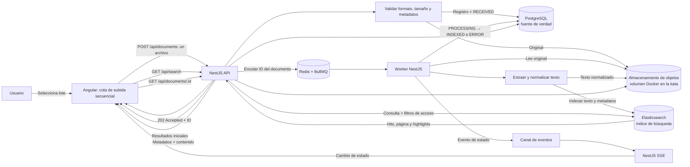

# Arquitectura: carga, indexación, búsqueda y visualización

## Propósito y decisiones base

La aplicación permite cargar documentos técnicos, procesarlos e indexarlos en segundo plano, recibir cambios de estado en tiempo real, buscar por contenido y visualizar un documento. El diseño usa Angular + TypeScript, NestJS + TypeScript, PostgreSQL, Elasticsearch, Redis + BullMQ y Server-Sent Events (SSE). Docker Compose coordina el entorno de desarrollo y demostración.

Los estados persistidos del documento son `RECEIVED`, `PROCESSING`, `INDEXED` y `ERROR`, según `docs/decisiones-tecnicas.md`. Angular muestra etiquetas en español. `PENDIENTE` y `SUBIENDO` pertenecen solamente a la cola temporal de Angular.

## Razones del stack elegido

| Tecnología | Motivo de selección | Costo o límite que se acepta |
| --- | --- | --- |
| Angular + TypeScript | Resuelve una interfaz con varios estados coordinados: selección de lote, subida secuencial, progreso por documento, búsqueda, filtros, visor y actualización SSE. TypeScript comparte contratos claros entre componentes frontend. | Requiere modelar explícitamente estados locales de lote y traducir códigos de estado/error del backend a mensajes de interfaz. |
| NestJS + TypeScript | Organiza API REST, validación, permisos, servicios de documento, integración con BullMQ y endpoints SSE bajo módulos y proveedores separados. El mismo lenguaje y tipos facilitan mantener contratos con Angular. | El backend debe separar API y worker en procesos ejecutables distintos para que extracción intensiva no afecte peticiones y streams SSE. |
| PostgreSQL | Mantiene relaciones y restricciones para metadatos, versiones, permisos y estados, además de transacciones para registrar documentos y eventos outbox si se implementan. | No será el motor de búsqueda de contenido en esta decisión; hay que mantener consistencia eventual con la proyección Elasticsearch. |
| Elasticsearch | Cubre texto completo sobre contenido y metadatos, relevancia ponderada, filtros, paginación y fragmentos resaltados. Se alinea directamente con los requisitos de búsqueda y evita consultas `LIKE`. | Añade un servicio que configurar, vigilar y reconciliar. El volumen máximo aún no se conoce y su capacidad deberá comprobarse con pruebas representativas. |
| Redis + BullMQ | Mantiene trabajos asíncronos independientes, reintentos, backoff y concurrencia configurable para extracción e indexación. | Redis es una dependencia adicional y no reemplaza la cola secuencial de subida de Angular. Los trabajos deben ser idempotentes porque pueden reintentarse. |
| SSE | El flujo requerido es principalmente unidireccional: el servidor notifica cambios de estado al navegador. Es apropiado para progreso sin polling; Angular usa HTTP para enviar cargas y búsquedas. | Una conexión SSE puede cortarse; la interfaz debe reconectar y consultar el estado persistido. El balanceador debe permitir conexiones HTTP de larga duración. |
| Almacenamiento de objetos | Separa los binarios del modelo relacional y de Redis; el volumen Docker sirve para la kata, detrás de una interfaz que permita usar almacenamiento administrado en otro entorno. | El volumen local no ofrece por sí solo alta disponibilidad ni respaldo de producción. |
| Docker Compose | Permite levantar el conjunto de dependencias de forma reproducible en desarrollo y demostración. | Su uso queda limitado al entorno local; no determina la plataforma de producción. |

La selección responde a los requisitos funcionales y a la prueba de un día, pero implica más infraestructura que una solución basada solo en PostgreSQL Full-Text Search. Para mantener el alcance, se limita la primera versión a un flujo de ingestión, un índice explícito, una búsqueda paginada y una interfaz SSE; no incluye OCR ni búsqueda semántica.

## Diagrama de arquitectura y flujo

## Flujo de carga e indexación

1. Angular permite seleccionar un lote de tamaño variable. Mantiene una cola local y envía un solo archivo a la vez. El archivo siguiente no empieza a subirse hasta que el backend responde al anterior.
2. Angular envía cada archivo y sus metadatos a `POST /api/documents` como `multipart/form-data`.
3. NestJS valida autorización, formato real, tamaño, campos y metadatos. Se aceptan TXT UTF-8, Markdown UTF-8 y PDF con texto extraíble; no se hace OCR en esta versión.
4. El backend conserva el original en almacenamiento durable. Para la kata se usa un volumen local de Docker detrás de una interfaz de almacenamiento; la misma interfaz permitirá usar almacenamiento de objetos administrado en otro entorno.
5. PostgreSQL registra metadatos, referencia al objeto original y estado inicial `RECEIVED`. La solicitud devuelve `202 Accepted` con el ID del documento solo cuando archivo y trabajo quedaron aceptados de forma recuperable.
6. NestJS publica en BullMQ un trabajo que contiene el ID del documento y referencias necesarias, no los bytes del archivo. El estado pasa a `PROCESSING` mientras el trabajo espera o está activo. Si se implementa transactional outbox, el evento pendiente se escribe en PostgreSQL dentro de la misma transacción del registro; un dispatcher lo publica a Redis.
7. El worker recupera el archivo, extrae y normaliza texto. Conserva el texto normalizado para que el visor pueda leer el documento y para permitir una reconstrucción del índice. El original se conserva según la política de retención.
8. El worker envía a Elasticsearch una proyección con el texto indexable, título, metadatos, etiquetas, versión e identificador estable. El trabajo debe ser idempotente, usando el ID del documento como clave para que un reintento no duplique resultados.
9. Una vez que Elasticsearch confirma la operación de indexación, el backend actualiza el registro PostgreSQL a `INDEXED`. Si ocurre un fallo definitivo o se agotan los reintentos, registra `ERROR` y un código/mensaje visible. Los errores transitorios pueden reintentarse según la política de BullMQ.
10. El cambio de estado se publica como evento SSE. El error de un archivo solo afecta a ese documento; Angular muestra su resultado y continúa con el próximo elemento de la cola.

### Fallos y consistencia

- PostgreSQL es la fuente de verdad para metadatos y estado. Elasticsearch es un índice derivado que se puede reconstruir a partir del contenido conservado.
- Almacenar el archivo y publicar el trabajo en Redis son operaciones entre sistemas distintos y no forman una transacción distribuida. Si se necesita garantizar la publicación tras una caída entre ambas operaciones, implementar transactional outbox. Para un prototipo sin outbox, añadir compensación y reconciliación que detecten documentos atascados en `RECEIVED`/`PROCESSING` y objetos sin registro.
- Si el almacenamiento falla antes de que la API acepte la carga, responder con error y no crear un documento procesable. Si falla la publicación del trabajo después de guardar el registro, no dejarlo indefinidamente en `RECEIVED` o `PROCESSING`; recuperar mediante outbox o marcar error recuperable y permitir reintento.
- BullMQ puede volver a ejecutar trabajos; extracción, escritura del texto normalizado e indexación deben ser idempotentes. Limitar reintentos, registrar el último error y permitir reintento individual.
- No marcar `INDEXED` hasta que Elasticsearch confirme el documento. Si la actualización de estado en PostgreSQL falla después de indexar, la reconciliación debe completar el estado sin crear duplicados.
- PDF protegido, corrupto o sin texto extraíble termina en `ERROR` con código y mensaje comprensibles. El worker continúa con los demás trabajos y Angular continúa con los archivos restantes.
- El usuario puede reconectar SSE y consultar `GET /api/documents/:id` para obtener el estado vigente. SSE complementa la consulta persistida; no es la única copia del estado.

## Errores, reintentos y cargas simultáneas

### Una operación de lote, trabajos independientes

Angular permite seleccionar varios archivos e iniciar una sola carga múltiple desde la interfaz. El frontend conserva una cola con el progreso por archivo, pero hace una solicitud `POST /api/documents` por cada documento y espera la respuesta antes de subir el siguiente. Así se mantiene la subida secuencial acordada sin convertir el lote entero en una única transacción HTTP.

Cada documento aceptado crea un trabajo BullMQ independiente, identificado con el ID estable del documento. Un error en validación, transferencia o procesamiento queda asociado a ese elemento. Angular registra el fallo y continúa con el siguiente archivo; un job fallido o en backoff no debe detener otros jobs listos. Pueden coexistir varios lotes o usuarios. El límite de subida es uno por lote desde Angular; la concurrencia de workers es independiente y configurable.

### Clasificación y política de recuperación

| Clase | Ejemplos | Tratamiento |
| --- | --- | --- |
| Permanente / requiere corregir el archivo | `UNSUPPORTED_FILE_TYPE`, `FILE_TOO_LARGE`, `EMPTY_FILE`, `INVALID_METADATA`, `DUPLICATE_FILE`, `FILE_CORRUPTED`, `PASSWORD_PROTECTED`, `UNSUPPORTED_ENCODING`, `NO_EXTRACTABLE_TEXT` o `OCR_REQUIRED`. | No reintentar automáticamente. Mostrar la causa y una acción correctiva. El usuario puede subir una versión corregida como nuevo intento. |
| Transitorio / posiblemente recuperable | `UPLOAD_FAILED`, `STORAGE_UNAVAILABLE`, `QUEUE_UNAVAILABLE`, `PROCESSING_TIMEOUT`, `SEARCH_ENGINE_UNAVAILABLE`; otros fallos de infraestructura claramente temporales. | Permitir hasta 3 reintentos adicionales (4 intentos totales), con backoff exponencial y variación aleatoria (jitter), manteniendo idempotencia. Angular reintenta transferencias y BullMQ jobs aceptados; agotados los intentos se registra el error y la cola avanza. |
| Desconocido | Error no clasificado de extracción o indexación. | Registrar una referencia de soporte; no marcar como recuperable sin evidencia. Si el job es idempotente, ofrecer reintento manual individual después de revisar la causa. |

Al agotarse los reintentos, el documento termina en `ERROR` con código y causa legible. El usuario puede solicitar un reintento manual individual después de corregir la causa, cuando corresponda. Los errores permanentes se marcan fallidos sin consumir reintentos inútiles. Si una respuesta se pierde después de que el servidor aceptó el archivo, Angular reutiliza la clave de idempotencia para evitar crear un duplicado.

### Progreso y resumen del lote

- Para cada archivo, la UI muestra nombre, estado de transferencia/procesamiento, mensaje y si existe acción de reintento.
- Estados como `PENDIENTE` y `SUBIENDO` pertenecen al frontend; el backend persiste `RECEIVED`, `PROCESSING`, `INDEXED` o `ERROR`.
- La UI presenta un contador de indexados, fallidos y pendientes/procesándose. El lote queda “completo” cuando cada archivo terminó en `INDEXED` o `ERROR`, incluyendo fallos locales de archivos que el servidor rechazó antes de crear un documento.
- Los errores usan códigos estables y reportan etapa, mensaje seguro, `retryable` y referencia de soporte. La UI no muestra trazas ni detalles internos.
- Ejemplo de resumen: “2 indexados · 3 fallidos”, con una fila por documento y su motivo concreto. La falla de `informe.docx`, por ejemplo, no detiene `manual.pdf`, `notas.md` ni los otros archivos.
- La cantidad de archivos por lote tendrá un límite configurable. El valor numérico debe fijarse con pruebas representativas, junto con el tamaño máximo por archivo y la concurrencia del worker.
- Si se cierra la pestaña, se puede perder la cola local de archivos aún no enviados; los documentos aceptados siguen recuperables mediante sus IDs y consulta de estado. La persistencia/reanudación del lote queda fuera del alcance inicial.

Concurrencia, tamaño máximo por archivo, tasa de entrada y capacidad de almacenamiento siguen sujetos a controles operativos. No se declara una capacidad máxima hasta medirla con lotes y workers representativos.

## Flujo de búsqueda y visualización

1. Angular envía la consulta, filtros y paginación a `GET /api/search`.
2. NestJS valida la solicitud y determina la identidad/permisos. Los filtros de acceso se incorporan a la consulta de Elasticsearch antes de devolver resultados.
3. Elasticsearch busca sobre título, autor, categoría, etiquetas, versión y texto extraído normalizado. Se configura análisis lingüístico en español para campos de texto, campos exactos para filtros cuando aplique, relevancia ponderada y fragmentos resaltados. No se usan `LIKE` ni recorridos completos de tablas para buscar contenido.
4. La API responde con resultados paginados, campos de resumen y fragmentos resaltados. La primera página propone un máximo de 20 resultados. Usar orden estable; evaluar `search_after` cuando el volumen o la profundidad de paginación lo amerite.
5. Al seleccionar un resultado, Angular pide `GET /api/documents/:id`. NestJS obtiene metadatos/estado de PostgreSQL y el contenido original o normalizado del almacenamiento. La vista permite leer el documento sin descargarlo manualmente.

La búsqueda no extrae texto ni indexa sincrónicamente. Tampoco carga el documento completo en cada resultado ni ejecuta una consulta individual a PostgreSQL por cada hit. La latencia se mide con las métricas y condiciones descritas en esta decisión: p95 propuesto ≤ 400 ms en backend y p95 propuesto ≤ 1.000 ms percibido, pendiente de validación con el evaluador.

El motor seleccionado es Elasticsearch por sus capacidades de texto completo, relevancia, filtros y resaltado. PostgreSQL Full-Text Search con GIN/`tsvector` tiene menor complejidad operativa y se considera una alternativa futura si las mediciones del volumen real justifican simplificar la arquitectura. El volumen máximo no se presupone; se determinará con pruebas de carga reproducibles. La comparación y los motivos están registrados en `docs/decisiones-tecnicas.md`.

## Comunicación SSE

- Angular abre la conexión de eventos autorizada antes de iniciar la carga. El transporte de archivos sigue siendo una solicitud REST individual por documento; los eventos SSE reportan progreso y estado del backend.
- Emitir un evento por transición de estado con `eventId`, `documentId`, estado (`RECEIVED`, `PROCESSING`, `INDEXED` o `ERROR`), etapa, código de error opcional, mensaje seguro, `retryable`, número de intento y marca temporal. No incluir trazas ni datos sensibles.
- La autorización limita los documentos/eventos visibles a los que el usuario puede consultar. Para EventSource, usar sesión mediante cookie segura o el mecanismo autorizado que permita el cliente; no poner tokens secretos en la URL.
- SSE es un canal de notificación, no la fuente de verdad. Tras reconectar, Angular consulta `GET /api/documents/:id` para cada elemento aceptado que siga sin estado terminal; PostgreSQL devuelve el estado vigente. No se depende de reproducir eventos perdidos.
- En una instancia, NestJS puede entregar eventos dentro del proceso. Con varias instancias de API/workers, el worker publica los eventos en un canal compartido (por ejemplo, Redis Pub/Sub) y cada instancia de API los distribuye a sus conexiones SSE locales; así el evento llega aunque la conexión del navegador esté en otra instancia.
- El balanceador y proxy deben permitir `text/event-stream`, desactivar buffering para esa ruta y configurar un timeout de inactividad compatible. Enviar keep-alives cuando corresponda y liberar suscripciones al cerrar la conexión.

## Escalabilidad y operación

La arquitectura escala cada componente por separado. No se fija una capacidad máxima antes de medir el tamaño y distribución de documentos, concurrencia y recursos del entorno.

| Componente | Estrategia de escala | Señales para escalar o revisar |
| --- | --- | --- |
| Angular / transferencia | El límite por lote es configurable. Cada lote sube con concurrencia 1; diferentes usuarios/lotes pueden operar en paralelo. El binario se transmite bajo demanda, no se carga todo el lote en memoria. | Duración de lote, errores de red, transferencias activas, límite del proxy y almacenamiento disponible. |
| API NestJS | Mantener API sin estado local de documentos y ejecutar varias instancias detrás de un balanceador. Usar pools de conexión limitados hacia PostgreSQL y Elasticsearch. | Latencia p95/p99, CPU/memoria, conexiones ocupadas, solicitudes rechazadas y errores por dependencia. |
| SSE | Mantener conexiones largas distribuidas entre instancias API; compartir eventos desde workers con Pub/Sub y habilitar balanceo que soporte streaming. Cada instancia atiende sus propias conexiones. | Conexiones activas por instancia, desconexiones, reconexiones, retraso entre transición y evento, límites del proxy. |
| Workers BullMQ | Escalar workers horizontalmente y ajustar concurrencia por worker independientemente de la subida. Aislar parsing CPU-intensivo en procesos/worker dedicados. Aplicar backpressure si la cola crece más rápido que la capacidad. | Profundidad/antigüedad de cola, tiempo de procesamiento, CPU/memoria, trabajos stalled, reintentos y errores. |
| PostgreSQL | Indexar claves de consulta/filtros y mantener límites del pool. Considerar optimización de consultas, particionamiento o réplicas de lectura solo cuando métricas lo justifiquen. | Tiempo de consulta, locks, conexiones, tamaño de tablas/índices, almacenamiento y carga de escritura. |
| Elasticsearch | Ajustar mapping/analyzers y medir tamaño del índice; ampliar nodos y revisar shards/replicas de acuerdo con volumen y tolerancia a fallos. Reindexar usando índice versionado/alias para reconstrucción segura. | Latencia de búsqueda, CPU/memoria, heap, almacenamiento, estado de shards, throughput y presión de indexación. |
| Redis / BullMQ | Dimensionar memoria, persistencia y disponibilidad; mantener políticas de retención para jobs completados/fallidos. Separar recursos de Redis si la cola o Pub/Sub compiten de forma significativa. | Memoria, latencia, conexiones, errores, backlog, reinicios y pérdida de disponibilidad. |
| Almacenamiento de objetos | Reemplazar volumen local por almacenamiento administrado compartido al pasar a varias instancias o producción; conservar claves en PostgreSQL y política de retención. | Capacidad, latencia de lectura/escritura, errores, costo y restauración de respaldos. |

### Evolución por etapas

1. **Kata local:** una instancia de API, un worker, PostgreSQL, Elasticsearch y Redis mediante Docker Compose; volumen local para originales; límites configurables y medición de una carga representativa.
2. **Mayor volumen:** varias instancias de API/workers, almacenamiento de objetos compartido, eventos SSE por Redis Pub/Sub y ajustes de concurrencia/índice guiados por métricas.
3. **Alta disponibilidad:** PostgreSQL, Elasticsearch y Redis administrados o con topología redundante; respaldos, recuperación probada, monitoreo y despliegues separados por componente.

El sistema aplica backpressure y límites configurables para tamaño por archivo, cantidad por lote, tasa de llegada y concurrencia. Los valores se determinan con pruebas de carga y límites del proveedor; no se prometen cargas ilimitadas.

## Contratos de API propuestos

| Método y ruta | Uso | Respuesta principal |
| --- | --- | --- |
| `POST /api/documents` | Recibir un archivo y metadatos | `202 Accepted`, `documentId`, estado inicial `RECEIVED`. |
| `GET /api/documents/:id` | Consultar metadatos, contenido y estado | Documento, estado y detalle de error opcional. |
| `GET /api/search` | Buscar texto completo con filtros y paginación | Hits, total/indicador de página y fragmentos resaltados. |
| `GET /api/events` | Recibir eventos de estado por SSE | Flujo de eventos autorizado. |

Los nombres de rutas son una propuesta para el diseño; se pueden ajustar al implementar, conservando las semánticas y criterios de aceptación.

## Criterios de aceptación

- La carga devuelve ID y `RECEIVED` sin esperar a extracción/indexación y solo tras aceptar archivo y trabajo de forma recuperable; el backend transiciona a `PROCESSING` durante cola/procesamiento.
- Angular envía los archivos de la cola de uno en uno; un archivo con error no bloquea los siguientes.
- El resumen del lote reporta cantidades de documentos indexados, fallidos y todavía procesándose, con causa y recuperabilidad por archivo.
- Originales y contenido normalizado quedan almacenados de forma persistente según la estrategia del entorno; PostgreSQL conserva metadatos/estado y Elasticsearch la proyección de búsqueda.
- El worker extrae e indexa fuera de la solicitud HTTP, con idempotencia, hasta 3 reintentos adicionales configurables para errores transitorios y errores aislados por documento.
- `INDEXED` se asigna luego de la confirmación de Elasticsearch; `ERROR` incluye código estable, mensaje seguro y referencia de soporte cuando aplique.
- SSE notifica estados y Angular puede recuperar estado por ID después de una desconexión.
- La búsqueda usa Elasticsearch, respeta permisos, devuelve paginación y fragmentos resaltados; no usa `LIKE` para contenido documental.
- El índice contiene identificador estable, título, autor, categoría, etiquetas, versión y texto normalizado, con análisis en español para búsqueda textual.
- El rendimiento se valida con volumen y concurrencia documentados; no se declara una capacidad máxima sin mediciones.
- El detalle muestra metadatos y contenido estructurado sin requerir descargar el original.
- La medición de latencia publica entorno, dataset, mezcla de consultas, concurrencia, muestras, p50, p95, máximo observado, errores y throughput.
- El máximo por lote, tamaño máximo por archivo y concurrencia de workers son configurables, validados en backend y medidos con pruebas de carga.
- Cada transición, intento y fallo se registra con ID de documento/trabajo, número de intento, timestamp, código de error y referencia diagnóstica.

## Decisiones pendientes

- [ ] Elegir transactional outbox o definir formalmente el alcance del mecanismo de compensación/reconciliación para PostgreSQL y Redis.
- [ ] Elegir el mecanismo concreto de autenticación SSE y configurar proxy/balanceador para streaming; aplicar el contrato de evento y Pub/Sub compartido descritos arriba cuando existan varias instancias.
- [ ] Definir formato y ubicación del contenido normalizado y política de retención de originales.
- [ ] Definir base/máximo del backoff, timeout por trabajo, política de pausa y recuperación de trabajos atascados; el máximo de reintentos transitorios ya está fijado en 3 reintentos adicionales.
- [ ] Definir el ámbito de deduplicación y la política cuando el contenido del archivo coincide pero sus metadatos/versiones difieren.
- [ ] Validar con el evaluador el conjunto de documentos, carga y criterio p95 para medir búsqueda.
