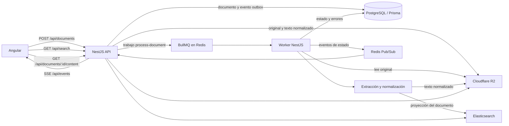

# Guía de lectura del backend

Esta guía recorre la implementación actual del buscador y visor de documentos. Describe qué hace cada componente, cómo se conectan PostgreSQL, Cloudflare R2, Redis/BullMQ y Elasticsearch, y qué parámetros gobiernan el comportamiento. Los valores indicados son los defaults del repositorio; las variables del entorno pueden cambiarlos.

> Esta guía describe código existente, no solo la arquitectura propuesta. En la implementación actual también se admite DOCX. La carga masiva tiene límites configurables (por defecto, 20 archivos y 100 MB totales) y cada archivo está limitado a 25 MB por la validación del servicio. El controlador tiene límites de protección de 50 archivos y 30 MB por archivo.

## Vista general

Los roles son deliberadamente distintos:

- **PostgreSQL es la fuente de verdad** para usuarios, claves API, metadatos, propiedad, estado y errores de procesamiento.
- **R2 guarda los bytes** del original y una copia del texto normalizado; PostgreSQL conserva las claves con las que se encuentran esos objetos.
- **Elasticsearch es una proyección reconstruible** optimizada para consultas de texto, filtros, relevancia, facetas y resaltado. No sustituye el registro de PostgreSQL.
- **Redis** sirve tanto para sesiones/caché y eventos Pub/Sub como para persistir el estado de los trabajos de BullMQ.
- **BullMQ** administra los trabajos de procesamiento; el worker hace extracción e indexación fuera de la solicitud HTTP de carga.

## Recorrido del backend por archivos

### Arranque y módulos

- [`backend/src/main.ts`](../backend/src/main.ts): arranca la API NestJS, activa `cookie-parser`, Helmet, CORS con credenciales, prefijo `/api`, validación global, filtro de errores y hooks de apagado.
- [`backend/src/app.module.ts`](../backend/src/app.module.ts): conecta los módulos de configuración, limitación de solicitudes, PostgreSQL, Redis, almacenamiento, cola, autenticación, documentos, outbox, búsqueda y eventos. El límite global de solicitudes está configurado en **60 por minuto**.
- [`backend/src/config/env.validation.ts`](../backend/src/config/env.validation.ts): valida y aplica defaults a las variables de entorno con Zod.
- [`backend/src/config/configuration.ts`](../backend/src/config/configuration.ts): organiza esas variables en opciones para los servicios.
- [`backend/src/worker.ts`](../backend/src/worker.ts) y [`backend/src/worker/worker.module.ts`](../backend/src/worker/worker.module.ts): arrancan un contexto Nest separado que consume trabajos. La API y el worker son procesos que se pueden desplegar y escalar por separado.

### API de documentos y carga

[`backend/src/documents/documents.controller.ts`](../backend/src/documents/documents.controller.ts) expone las rutas protegidas por autenticación:

| Ruta | Función |
|---|---|
| `POST /api/documents` | Recibe un archivo y sus metadatos; devuelve `202 Accepted`. Acepta `Idempotency-Key`. |
| `POST /api/documents/batch` | Recibe un lote en `files` y metadatos JSON alineados por índice. |
| `GET /api/documents/:id` | Devuelve metadatos y trata de leer el texto normalizado. |
| `GET /api/documents/:id/content` | Transmite el original desde R2 y admite encabezado `Range` para lectura parcial. |
| `POST /api/documents/:id/retry` | Restablece a `PROCESSING` un documento en `ERROR` y vuelve a publicarlo. |

[`backend/src/documents/documents.service.ts`](../backend/src/documents/documents.service.ts) coordina la carga. Valida la presencia del archivo, contenido vacío, tamaño, nombre, extensión y algunos encabezados/marcadores del archivo; normaliza categorías y etiquetas; calcula SHA-256; crea claves de objeto deterministas; guarda el original en R2; y en una transacción PostgreSQL crea el documento y el evento outbox. Si falla esa transacción, intenta borrar el objeto que ya se había guardado. La clave de idempotencia se aplica por usuario, para que una repetición no cree otro documento.

En `createBatch`, cada archivo se procesa secuencialmente en el backend dentro de un `try/catch` individual. El resultado registra `accepted` o `failed` por archivo, de modo que un error de validación o almacenamiento de uno no detenga los siguientes. El frontend también mantiene su propia cola de transferencias; la secuencialidad del frontend y la del lote del endpoint son mecanismos distintos.

El servicio permite `.pdf`, `.txt`, `.md`, `.markdown` y `.docx`. La lista de formatos del código debe mantenerse alineada con el alcance de producto y la interfaz; la decisión previa de admitir solo TXT, PDF y Markdown no coincide hoy con la implementación DOCX.

### Extracción y normalización

[`backend/src/extraction/extraction.service.ts`](../backend/src/extraction/extraction.service.ts) selecciona el extractor por extensión:

- TXT y Markdown se decodifican como UTF-8.
- PDF se procesa con `pdf-parse`.
- DOCX se procesa con `mammoth.extractRawText`.

El texto se normaliza: se quita BOM y NUL, se uniforman saltos de línea, se reducen líneas vacías consecutivas, se eliminan espacios finales y se recorta a `MAX_TEXT_CHARS` (2.000.000 por defecto). El PDF sin texto seleccionable produce `NO_EXTRACTABLE_TEXT`; el mensaje informa que OCR no está incluido. Archivos protegidos por contraseña y corruptos tienen errores diferenciados. No se intenta OCR.

### Almacenamiento de archivos

[`backend/src/storage/r2-storage.service.ts`](../backend/src/storage/r2-storage.service.ts) implementa la interfaz S3-compatible mediante AWS SDK. Las claves siguen el patrón `documents/{userId}/{documentId}/original.{ext}` y `.../normalized.txt`. Puede guardar, recuperar (también por rango), borrar, comprobar el bucket y generar URLs firmadas de lectura. El TTL configurado para estas URLs es 300 segundos, aunque el flujo actual del visor transmite el contenido a través de la API.

La implementación concreta se inyecta mediante el token `OBJECT_STORAGE`, lo que desacopla los servicios de la marca/proveedor. Si R2 no está configurado, las operaciones de almacenamiento devuelven `STORAGE_UNAVAILABLE`.

### Outbox, Redis y BullMQ

[`backend/src/outbox/outbox.service.ts`](../backend/src/outbox/outbox.service.ts) resuelve la brecha entre una transacción PostgreSQL y la publicación en Redis. El documento y su evento `PENDING` se escriben en la misma transacción. La API intenta publicar de inmediato, pero si Redis no está disponible deja el evento persistido para recuperación.

El reconciliador corre cada 15 s por defecto; realiza una primera pasada 3 s después del arranque, procesa hasta 20 eventos pendientes por pasada y busca documentos `PROCESSING` sin trabajo activo luego de 120 s. Los eventos fallidos reciben espera exponencial acotada y se conserva el último error; `OUTBOX_MAX_ATTEMPTS` (10) registra el umbral máximo configurado. El evento no se pierde al reiniciar la API porque vive en PostgreSQL.

[`backend/src/queue/queue.module.ts`](../backend/src/queue/queue.module.ts) toma host, puerto, credenciales, base de datos y TLS desde `REDIS_URL`. La cola se llama `documents`; cada trabajo se llama `process-document`, contiene un `documentId`, utiliza ese ID como clave de trabajo en la ruta habitual, permite 4 intentos (incluido el inicial), usa backoff exponencial de 2 s y conserva hasta 100 trabajos completados y 500 fallidos. Las operaciones de cola tienen timeout por defecto de 2 s.

BullMQ usa Redis para coordinar y conservar el estado de sus trabajos. [`backend/src/redis/redis.service.ts`](../backend/src/redis/redis.service.ts) configura ioredis con `maxRetriesPerRequest: null`, opción necesaria para las conexiones de worker de BullMQ. Esto no equivale a tener una cola ilimitada: el throughput depende del worker, Redis, almacenamiento y Elasticsearch.

Redis tiene además otros dos usos explícitos: guardar sesiones `sid` con expiración de 7 días y caché de usuario de 30 s, y distribuir eventos SSE entre instancias de API mediante Pub/Sub. Pub/Sub es efímero: si un cliente está desconectado en el momento de emisión, ese evento no se conserva como historial. El estado durable se consulta en PostgreSQL.

### Worker de procesamiento

[`backend/src/worker/document.processor.ts`](../backend/src/worker/document.processor.ts) consume la cola `documents` con concurrencia predeterminada de 2 (`WORKER_CONCURRENCY`). Para cada trabajo:

1. Carga el documento de PostgreSQL y omite los que ya estén `INDEXED` (idempotencia básica).
2. Establece `PROCESSING` y publica un evento de etapa `extraction`.
3. Reutiliza texto normalizado de R2 si existe; si no, lee el original y extrae el texto.
4. Guarda el texto normalizado en R2.
5. Indexa metadatos y contenido en Elasticsearch.
6. Solo después de confirmar la indexación marca `INDEXED` y `indexedAt` en PostgreSQL, y emite el evento.
7. Ante fallos transitorios mantiene `PROCESSING` durante los reintentos; al terminarse los intentos o ante fallos permanentes marca `ERROR` y guarda código/mensaje.

El timeout de extracción/indexación es 60 s por etapa. La promesa se rechaza al expirar; como sucede con `Promise.race`, esto no necesariamente cancela internamente una operación de librería que ya empezó. BullMQ proporciona los reintentos del trabajo y el processor clasifica errores permanentes como `UnrecoverableError`.

### PostgreSQL y Prisma

[`backend/prisma/schema.prisma`](../backend/prisma/schema.prisma) describe cuatro piezas principales:

- `User`: cuenta, hash de contraseña Argon2id y marca de desactivación.
- `ApiKey`: claves API guardadas como hash SHA-256, con prefijo visible, expiración, revocación y última utilización.
- `Document`: propiedad, título, autor, categorías, etiquetas, versión, nombre original, tamaño, SHA-256, ubicación en R2, estado, timestamps y error visible. Tiene unicidad por `(userId, idempotencyKey)` e índices por propietario/estado y checksum.
- `OutboxEvent`: publicación pendiente o publicada, intentos, próxima fecha disponible y último error.

Prisma controla el acceso relacional y las migraciones. El patrón de configuración contempla `DATABASE_URL` con endpoint pooled de Neon para ejecución de la aplicación y `DIRECT_URL` directo para operaciones de migración. PostgreSQL no almacena los bytes ni es el motor principal de búsqueda de contenido; sí mantiene los datos autoritativos necesarios para permisos, recuperación, filtros de estado y auditoría operativa.

### Elasticsearch: mapeo y consultas

[`backend/src/search/search.service.ts`](../backend/src/search/search.service.ts) conecta con `ELASTICSEARCH_NODE`; si hay API key, la añade a la conexión. Al iniciar comprueba/crea un índice concreto `{ELASTICSEARCH_INDEX}-{ELASTICSEARCH_INDEX_VERSION}` (por defecto `documents-v2`) y el alias lógico `documents`. La versión permite preparar un índice nuevo y migrar el alias al reconstruir/reindexar. Si el alias ya existe pero el índice no tiene los subcampos de prefijo, el arranque registra un aviso y pide reindexar en lugar de fallar.

El mapping está en [`backend/src/search/document-index.mapping.ts`](../backend/src/search/document-index.mapping.ts): título, descripción, contenido, autor y metadatos usan analyzer `spanish`; campos para filtro exacto usan `keyword`; tamaño usa `long`; fecha usa `date`. Los campos de texto llevan un subcampo `prefix` con `edge_ngram` 3–20 y un analizador propio sin *stemming* (`prefix_index` al indexar, `prefix_search` al consultar), que es lo que permite resolver `arqui` → `arquitectura`. Se indexan campos de autorización (`userId`) y estado para filtrar en la consulta. El contenido completo vive en el índice como proyección para búsqueda, además del texto normalizado conservado en R2.

Las búsquedas filtran siempre por usuario y estado `INDEXED`. Se consultan título (peso 3), descripción (peso 2), contenido y metadatos (peso 2) con dos cláusulas combinadas en `bool.should` (`minimum_should_match: 1`): la búsqueda por término con `fuzziness: AUTO` y la búsqueda por prefijo sobre los subcampos `*.prefix`. Una frase entre comillas se resuelve solo con `match_phrase` y sin tolerancia. Admite categoría, tags y autor, orden por relevancia/título/fecha, paginación (máximo 100 por página), facetas de categorías/tags/autores y resaltado de hasta tres fragmentos de contenido de 180 caracteres. La indexación usa `refresh: wait_for`; esto evita marcar `INDEXED` antes de que el documento sea visible en búsqueda, a costa de que el worker espere el refresh.

La búsqueda no hace `LIKE` ni extrae archivos en el camino de consulta. Elasticsearch puede reconstruirse a partir de documentos y texto persistidos, mediante los scripts de reindexación/backfill disponibles en `backend/scripts`; el script de reindexación crea el índice con los `settings` vigentes y mueve el alias, que es la única forma de poblar un subcampo nuevo.

### Estados y notificaciones al frontend

El enum de PostgreSQL contempla `RECEIVED`, `PROCESSING`, `INDEXED`, `ERROR`; el flujo actual crea directamente en `PROCESSING`, por lo que `RECEIVED` existe en el modelo pero no es una transición normal observada en esta carga. Los errores transitorios quedan asociados al documento mientras sigue `PROCESSING`; `ERROR` representa el estado terminal hasta un reintento manual.

[`backend/src/events/events.service.ts`](../backend/src/events/events.service.ts) publica JSON en el canal Redis `document-events`, y cada instancia API lo recibe mediante una conexión suscriptora propia. [`backend/src/events/events.controller.ts`](../backend/src/events/events.controller.ts) ofrece SSE autenticado en `/api/events`, filtrado por usuario, con `ping` cada 15 s. El frontend recibe cambios como `PROCESSING`, `INDEXED`, `ERROR`, etapas, intento, mensaje y código de error.

## Autenticación, seguridad y operación

- [`backend/src/auth/auth.service.ts`](../backend/src/auth/auth.service.ts) crea sesiones aleatorias en Redis, hashea contraseñas con Argon2id y valida claves API comparando su SHA-256 con PostgreSQL.
- [`backend/src/auth/auth.guard.ts`](../backend/src/auth/auth.guard.ts) acepta sesión por cookie `sid` o API key con `Authorization: Bearer ...`. Las rutas mutables también usan protección CSRF cuando la autenticación se basa en cookie.
- La carga aplica validación global con `class-validator`/`class-transformer`; el filtro global convierte errores de aplicación a respuestas HTTP estructuradas.
- `GET /api/health` consulta PostgreSQL, Redis, Elasticsearch y R2 en paralelo y devuelve `ok` o `degraded` con el estado de cada dependencia.
- Nest aplica Helmet, CORS limitado a `FRONTEND_ORIGIN`, cookies con credenciales y throttling global 60/minuto.

## Parámetros configurables principales

Los defaults provienen de [`backend/src/config/env.validation.ts`](../backend/src/config/env.validation.ts) y aparecen en [`.env.example`](../.env.example):

| Variable | Default | Efecto |
|---|---:|---|
| `DATABASE_URL` | Obligatoria | PostgreSQL de runtime (Neon pooled según plantilla). |
| `DIRECT_URL` | Vacía/opcional | URL directa de PostgreSQL para migraciones Prisma. |
| `REDIS_URL` | `redis://localhost:6379` | Redis de BullMQ, sesiones, caché y Pub/Sub; `rediss://` activa TLS para BullMQ. |
| `ELASTICSEARCH_NODE` | `http://localhost:9200` | Nodo Elasticsearch. |
| `ELASTICSEARCH_INDEX` / `ELASTICSEARCH_INDEX_VERSION` | `documents` / `v1` | Alias y sufijo de versión del índice concreto. |
| `ELASTICSEARCH_API_KEY` | Vacía | Autenticación opcional del cliente Elasticsearch. |
| `R2_ACCOUNT_ID`, `R2_ACCESS_KEY_ID`, `R2_SECRET_ACCESS_KEY` | Vacías | Credenciales y endpoint de Cloudflare R2; si falta endpoint se deriva del account ID. |
| `R2_BUCKET` / `R2_REGION` | `technical-documents` / `auto` | Bucket y región S3-compatible. |
| `R2_SIGNED_URL_TTL_SECONDS` | 300 | Vigencia de URLs firmadas. |
| `MAX_FILE_SIZE_MB` | 25 | Validación del tamaño por archivo en el servicio. |
| `MAX_BATCH_FILES` / `MAX_BATCH_TOTAL_MB` | 20 / 100 | Límites de cantidad y suma de bytes del lote en el servicio. |
| `WORKER_CONCURRENCY` | 2 | Trabajos procesados simultáneamente por proceso worker. |
| `QUEUE_OPERATION_TIMEOUT_MS` | 2000 | Tiempo máximo de espera de la API al operar con la cola. |
| `OUTBOX_RECONCILE_INTERVAL_MS` | 15000 | Intervalo de recuperación/publicación de outbox. |
| `OUTBOX_STUCK_AFTER_MS` / `OUTBOX_MAX_ATTEMPTS` | 120000 / 10 | Detección de PROCESSING atascados y umbral de reintentos del outbox. |
| `MAX_TEXT_CHARS` | 2000000 | Máxima longitud normalizada considerada por documento. |
| `PROCESSING_TIMEOUT_MS` | 60000 | Timeout por etapa de procesamiento/indexación. |
| `SESSION_SECRET` / `SESSION_TTL_SECONDS` | valor de desarrollo / 604800 | Secreto validado por longitud mínima y duración de sesión; el secreto debe reemplazarse en despliegues. |
| `FRONTEND_ORIGIN` / `PORT` | `http://localhost:4200` / 3000 | CORS y puerto de la API. |

**Matiz de límites HTTP:** el interceptor de Nest/Multer tiene topes duros locales de 30 MB por archivo y 50 archivos para el endpoint batch; después el servicio aplica los límites configurables de 25 MB, 20 archivos y 100 MB totales por defecto. Los límites efectivos son la combinación más restrictiva de proxy/plataforma, interceptor y validación del servicio. En particular, el lote real no es indeterminado: para retirar esos topes habría que cambiar código, configuración, memoria/streaming y límites del proveedor.

## Cómo se ejecuta localmente y despliegue

[`docker-compose.yml`](../docker-compose.yml) contiene Redis 7 con persistencia AOF, Elasticsearch 8.15.3 en modo single-node para desarrollo, migraciones Prisma, API Nest, worker y frontend. Elasticsearch local tiene seguridad desactivada para facilitar desarrollo; esto no debe copiarse a una instancia expuesta públicamente. PostgreSQL local está bajo el perfil opcional `local-db`; la configuración de ejemplo usa Neon externo, y R2 también es externo.

La topología recomendada permite escalar API y worker independientemente: aumentar réplicas API para tráfico HTTP/SSE, y réplicas/concurrencia de workers según el backlog y recursos disponibles. Redis, PostgreSQL, Elasticsearch y R2 también tienen límites propios y deben escalarse/monitorizarse como dependencias; subir `WORKER_CONCURRENCY` sin medir memoria, tamaño de PDF y capacidad de Elasticsearch puede empeorar latencias o saturar recursos.

La conversación previa consideró Render como opción de demo, pero los archivos de despliegue actuales no configuran Render: Compose describe el stack local, mientras que Neon y R2 se configuran por variables. Si se elige el plan gratuito de Render, la API puede dormir por inactividad y la disponibilidad de worker/Redis/PostgreSQL depende de las restricciones actuales del plan; conviene comprobarlas antes de usarlo para una demo que deba estar siempre despierta. :codex-annotation{index="1"}

## Límites conocidos y puntos a vigilar

1. **Alcance de formatos:** el código y mensajes incluyen DOCX aunque el alcance conversado inicialmente era TXT/PDF/Markdown.
2. **Lote secuencial en memoria:** Multer entrega buffers antes del procesamiento de cada archivo; los límites de tamaño y cantidad evitan cargas masivas ilimitadas y el consumo de memoria debe considerarse.
3. **Eventos SSE no durables:** Redis Pub/Sub no retiene mensajes para clientes desconectados. La UI debe reconciliar el estado consultando PostgreSQL/documentos después de reconectar.
4. **Outbox y reintentos:** el outbox hace durable el encolado frente a caídas entre PostgreSQL y Redis; BullMQ reintenta los trabajos. Son dos políticas distintas. Revisar y alertar sobre eventos cuyo contador llegue al umbral configurado.
5. **Visibilidad del índice:** el worker espera `refresh=wait_for` para marcar `INDEXED`, una decisión de consistencia que puede elevar el tiempo de indexación.
6. **Secreto de sesión:** el schema trae un default de desarrollo. El despliegue debe proveer un secreto aleatorio fuerte y no reutilizar el ejemplo.
7. **Objetivo de latencia:** `Server-Timing` reporta autenticación, Elasticsearch y total; hay registro estructurado de latencia. Esto instrumenta la medición, pero no demuestra por sí solo el objetivo p95 de 400 ms/1 s: ese objetivo requiere pruebas con volumen, concurrencia, red y hardware definidos.

## Glosario rápido

- **Outbox:** tabla durable en PostgreSQL que registra que hay un trabajo por publicar.
- **BullMQ:** librería de cola en Node.js; usa Redis para coordinar trabajos, retrasos, intentos y estados.
- **Worker:** proceso separado que toma trabajos y ejecuta extracción e indexación.
- **Índice Elasticsearch:** documentos derivados con campos preparados para búsqueda; regenerables desde los datos almacenados.
- **Alias:** nombre estable (`documents`) que apunta a un índice concreto versionado (`documents-v1`).
- **SSE:** conexión HTTP de un solo sentido que permite al backend enviar cambios al navegador.
- **Idempotencia:** protección para que una repetición de carga/reintento no cree efectos duplicados no deseados.
